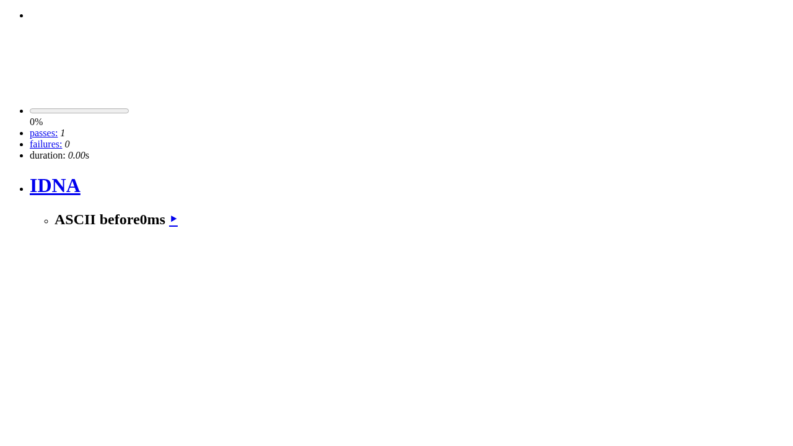
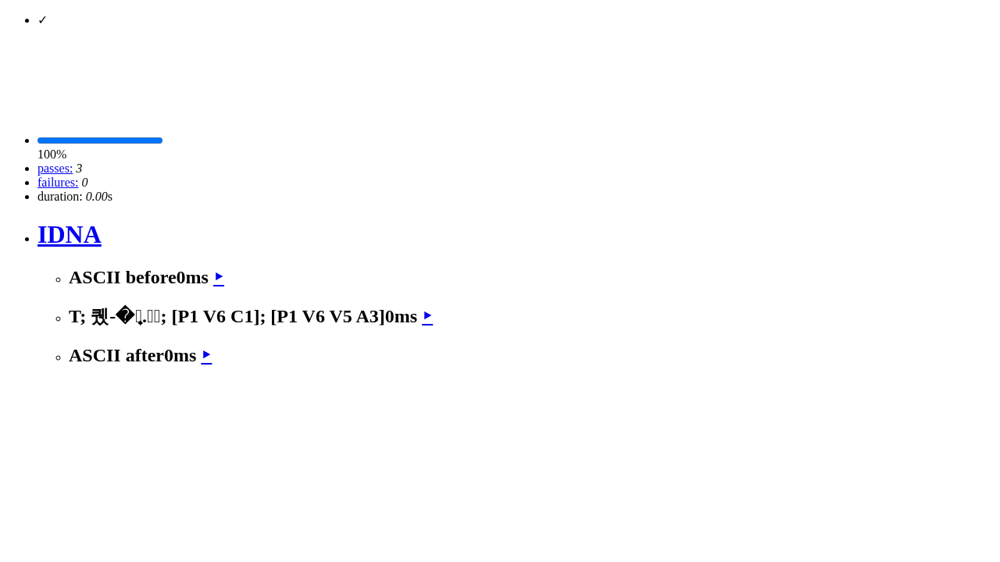

# Mocha HTML reporter: lone surrogate replay proof

Baseline: [`cb21a4eba550da665fb2c3fa1ce021777a191e23`](https://github.com/mochajs/mocha/commit/cb21a4eba550da665fb2c3fa1ce021777a191e23). Candidate: [`0c2fb3ac5fd648afc3f272490af2d6cc0238c5cf`](https://github.com/jipeng6036-del/mocha/commit/0c2fb3ac5fd648afc3f272490af2d6cc0238c5cf). Only `lib/reporters/html.js` and a new browser regression file change. The generated browser bundle is built by the official scripts, not committed.

## Reproduction and behavior

Issue [#1893](https://github.com/mochajs/mocha/issues/1893) supplies an IDNA test title containing lone UTF-16 surrogates. In the real built Mocha HTML reporter, the baseline run stops before the title is reported and never reaches the following ASCII test. A separate direct diagnostic identifies `URIError: URI malformed` from `encodeURIComponent` in `makeUrl`; this is not claimed to be an uncaught browser page error. The candidate completes all 3 original-fixture tests and clicking the replay link runs only the original target title (1 test). The original UTF-16 code units are preserved.

`browser-probe.mjs`, `original-title.json`, paired browser JSON/logs and the images below record the runtime fixture. The official Playwright test also uses the actual built `/mocha.js` and HTML reporter, follows real test and suite replay links, and retains the existing query parameter.

| Baseline | Candidate |
| --- | --- |
|  |  |

## Required checks

Environment: task-specific Debian Linux container, Node 22.23.4/npm 11.20.0; Chromium 153.0.8010.12. No model/service or paid call is used.

- Same final 8-case file and browser, retries disabled: baseline **6 fail / 2 pass**, candidate **8 pass**. Cases cover original IDNA, high/low/adjacent surrogates, a valid pair, literal escapes, suite titles and failed tests.
- Fresh root/docs locked installs (`npm ci --ignore-scripts`), followed by the exact required **`npm test`**, exit **0**. The composite runs full lint, all Node test groups/coverage, the full browser suite (**12 pass**) and webpack compatibility. See `candidate-fresh-npm-test.log` and `fresh-npm-test-results.json`.
- Separate `npm run format:check`, `npm run lint`, `npm run test-node`, `npm run test-browser`, `npm run tsc` pass. Separate gates use Node22.18.0; exact final composite uses Node22.23.4.
- Official `npm run test-smoke` passes on Node **20.19.0, 20.20.2, 22.12.0, 22.23.4, 24.22.1, 26.12.1**.

`results.json` maps commands, versions, durations and exit codes; `baseline-source-manifest.json` and `candidate-final-source-manifest.json` identify source bytes. `candidate-source-v1.diff` includes the new regression file. Scripts include the actual working directories and bootstrap sequence. To rerun the regression, run `npm run build` then `node node_modules/@playwright/test/cli.js test test/browser/html-reporter.spec.js --retries=0` in the candidate; use the same test-only file on the baseline for the red control. The official `npm run test-browser` includes its own clean/build.

## Retained setup failures and limits

The first ordinary-user browser run failed at the official Playwright `--with-deps` su/apt step. The same official command passed as root inside this isolated container; no lifecycle or test was skipped. Both logs remain.

Docs Knip's second warm-cache run reports `src/content.config.ts` unused. An unchanged baseline independently gives first-run0/second-run1 too; the paired red logs remain. Final validation follows a fresh CI bootstrap, installing docs and running `npm test` directly. No cache-disable option, configuration relaxation, dependency/lockfile change or unrelated source fix was added.

Hosted multi-OS CI is pending until submission. Local results do not claim the full Ubuntu/Windows hosted matrix or maintainer approval. Code was prepared and independently inspected with Codex; no human action or CLA signature is claimed.

`SHA256SUMS.json` lists the exact public files. No credentials, user environment, dependency tree or Git metadata is included.
